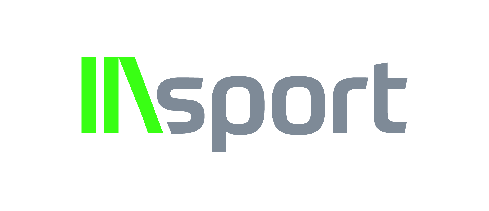

<div align="center">



# IAschool

A escola sobe fotos de um evento, revisa a separação por aluno e prepara a
entrega ao responsável, com autorização e trilha de auditoria.

</div>

**Documentação revisada em 25/10/2026 contra o código local.** Publicações
citadas são registros anteriores do repositório; não houve consulta ou deploy
remoto nesta revisão. O [BACKLOG.md](BACKLOG.md) separa implementação,
publicação registrada e pendências por fluxo.

## Estado do produto

| Fluxo | Implementado no código | Publicação registrada | Ainda pendente |
| --- | --- | --- | --- |
| Fundação escolar | Cadastro com aprovação, escolas, membros, turmas, alunos e responsáveis; isolamento por escola | Fundação em 20/09 e app em 26/09/2026 | CSV, telas administrativas restantes e configuração de e-mail |
| Fotos e reconhecimento | Eventos, upload em massa, deduplicação, miniaturas, referências, reconhecimento, revisão humana, pasta do aluno e ZIP | M1–M6 em setembro; referências de evento em 12/10/2026 | Medições de aceite e autorização para dados reais |
| Artes por aluno/turma | Wizard com modelo da escola, uma foto por aluno, fila persistente, cota e repetição manual | App e API v7 em 16/10/2026 | Aceite completo do wizard atual com geração real; templates de evento |
| Entregas e álbum | Seleção por família, fotos nítidas, aprovação, envio explícito condicionado e acesso privado | Fotos nítidas em 13/10; indicação de envio pausado em 15/10/2026 | Transporte ponta a ponta e liberação comercial |
| Link reutilizável do álbum | Código e SQL locais; fotos disponíveis agrupadas por evento | Sem publicação registrada para essa alteração | Migration, publicação coordenada e validação remota |
| WhatsApp e consentimento | OTP sem código na resposta, provedor Z-API, limites, webhook e aceite direto por link | Fundação em 02/10; ensaio adulto em 03/10; consentimento em 05/10/2026 | Rotação de segredos registrada como pendente, webhook operacional, Meta e homologação do termo |

> [!IMPORTANT]
> **Foto real de criança ou adolescente e WhatsApp comercial continuam
> bloqueados pelas regras do projeto.** A exceção é o ensaio `controlled_zapi`
> com uma escola, 1–4 destinatários autorizados e material sintético/adulto.
> Código implementado e publicação anterior não fecham os
> [gates de produção](docs/pendencias-producao.md). O termo `delivery_whatsapp.v1`
> ainda promete desfoque e precisa de revisão antes de uso real com fotos nítidas.

## Desenvolvimento local

Requisitos do projeto: Node.js 24, pnpm 11.17.0 e Corepack no PATH; Python 3.12 para o face-worker.

```bash
corepack pnpm install --frozen-lockfile
PORT=5174 BASE_PATH=/ pnpm --filter @workspace/iaschool-app run dev
```

Sem as duas variáveis públicas `VITE_SUPABASE_URL` e
`VITE_SUPABASE_ANON_KEY`, o app usa dados de demonstração. Para conectar o app,
configure somente essas variáveis em `artifacts/iaschool-app/.env.local`.
O `.env.local` da raiz não é carregado automaticamente pelo servidor Vite.
`PORT` e `BASE_PATH` precisam estar no ambiente do processo, como no comando.

Em outro terminal, com as variáveis de servidor já exportadas:

```bash
PORT=5000 pnpm --filter @workspace/api-server run dev
```

O Vite local **não configura proxy de `/api`**. Subir os dois processos não
conecta automaticamente o wizard ou o álbum; o rewrite existente é da Vercel.
Setup, limites do ambiente local e comandos para Windows:
[desenvolvimento multiplataforma](docs/development/cross-platform-web.md).
Nomes de variáveis: [`.env.example`](.env.example); nunca versionar valores reais.

## Verificação

```bash
pnpm --filter @workspace/iaschool-app run test src
pnpm --filter @workspace/ingest-worker run test
pnpm run test:compat
pnpm run typecheck
PORT=5000 BASE_PATH=/ pnpm run build
```

**Não use `run test` sem filtro no app/API como verificação sem rede.** Essas
suítes também incluem integração com banco real; o app lê o `.env.local` da
raiz. Comandos separados para unitários, Python, Edge Functions e integrações:
[guia de testes](docs/development/testes.md). Não há script de lint.

## Workspace

| Diretório | Responsabilidade |
| --- | --- |
| `artifacts/iaschool-app` | UI, SQL de referência, Edge Functions e testes de integração |
| `artifacts/iaschool-ui` | Tokens, componentes e preview do design system |
| `artifacts/api-server` | Geração, cota, logs e proxy do álbum |
| `artifacts/ingest-worker` | Miniaturas, preparo das entregas, execução de artes em lote e expurgo |
| `artifacts/face-worker` | Detecção e reconhecimento facial em Python |
| `lib/api-spec`, `lib/api-client-react`, `lib/api-zod` | OpenAPI e código gerado; hoje cobrem somente `/healthz` |
| `artifacts/mockup-sandbox` | Protótipo visual |
| `lib/db` | Pacote Drizzle inerte; não representa o schema |
| `scripts` | Compatibilidade, apresentação, custos e experimentos |

Os contratos HTTP implementados estão em [docs/api.md](docs/api.md).
Não edite os clientes gerados à mão. Para alterações futuras no OpenAPI:
`pnpm --filter @workspace/api-spec run codegen`.

Os tokens vêm de `artifacts/iaschool-ui/tokens.json`; regenere com
`pnpm --filter @workspace/iaschool-ui run tokens`.

## Banco e segurança

Supabase fornece Postgres, Auth, RLS, Storage, Realtime, pgvector e cron.
O [inventário SQL](artifacts/iaschool-app/SUPABASE.md) identifica os arquivos
de referência e diferencia o histórico aplicado do complemento ainda local.
Schema remoto muda somente por `apply_migration` no MCP `supabase-iaschool`
da raiz, com autorização explícita. Nunca execute `@workspace/db push` ou
`push-force`: o schema Drizzle está vazio.

## Documentação

- [ONBOARDING.md](ONBOARDING.md): onde mexer e como começar.
- [AGENTS.md](AGENTS.md): regras de colaboração e segurança.
- [BACKLOG.md](BACKLOG.md): estado e trabalho restante.
- [Operação](docs/operacao-agentes.md): serviços, publicação, recuperação e lacunas.
- [Pendências de produção](docs/pendencias-producao.md): bloqueios para uso real.
- [API](docs/api.md) e [Supabase](artifacts/iaschool-app/SUPABASE.md): interfaces e dados.
- [Módulos](.context/modules/) e [convenções](.context/conventions.md): fronteiras do código.
- [Specs de outubro](docs/specs/ajustes-2026-10-11/overview.md): decisões por fluxo.
- [Pivotagem](docs/pivotagem-iaschool.md): plano histórico de 30/08/2026.
- [Consumo web](artifacts/iaschool-ui/docs/consuming-web.md) e [Expo](artifacts/iaschool-ui/docs/consuming-expo.md): design system.
